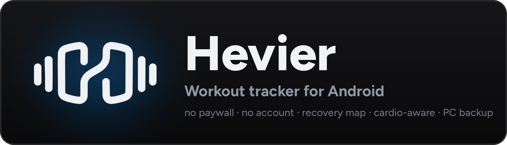

<p align="center">
  
</p>

<p align="center">
  <a href="https://github.com/hamzaamry/hevier/actions/workflows/check.yml"></a>
  <a href="https://sonarcloud.io/summary/new_code?id=hamzaamry_hevier"></a>
  <a href="https://sonarcloud.io/summary/new_code?id=hamzaamry_hevier"></a>
  <a href="LICENSE"></a>
  
</p>

<p align="center">
  <b>Log your sets fast, follow a training cycle, and see what your training does to each muscle.</b><br>
  Everything stays on your phone. No account, no ads, no subscription.
</p>

> **Unofficial.** Hevier is a hobby project inspired by the Hevy app. It is not
> affiliated with, endorsed by or connected to Hevy or its makers. "Hevy" is
> their trademark. Hevier contains no Hevy code or assets.

## Why Hevier

- **Every feature is free.** Long-range charts, set counts per muscle and the
  advanced statistics often sit behind a subscription elsewhere. Here they're
  part of the app, and the code is open.
- **Your data stays yours.** It lives on the phone in a SQLite database. No
  sign-up, no cloud, no tracking. Back it up to your own PC when you want.
- **Numbers with sources.** How sets are counted and how long a muscle stays
  tired come from published studies, each one cited in
  [`docs/science/`](docs/science/).
- **It works with the app closed.** The rest timer runs in the notification, with
  buttons, and four home-screen widgets keep your week in view.

## Features

### Logging
- Sets with weight and reps, time or distance; **warm-up** and **failure** sets
- **Rest timer** per exercise, with a buzz and a chime when it's over
- **Live PR medals** the moment a set beats your best: heaviest weight,
  estimated 1RM, best set volume, most reps, longest time or distance
- **"Reps left"** after your last set, so the app knows how hard it was
- **Per-hand weight** for dumbbell exercises
- A **clock** with a timer and a stopwatch, and Keep Awake while you train
- Edit, copy or delete a past workout, save one as a routine, or log a workout
  for a past day from the calendar

### Routines and cycle
- Routines in folders, reordered by drag and drop
- A **training cycle** (Upper A → Lower A → Upper B → …) that tells you what's
  next, on Home and in a widget
- After a workout, offers to update the routine with what you actually did

### Statistics <sub>all free</sub>
- **Body heat map**: this week's sets per muscle, in zones from below
  maintenance to growth
- **Recovery map**: how recovered each muscle is right now
- **Muscle distribution** radar, compared with the period before
- **Push / pull balance**, with a warning when one side runs far ahead
- **Set count per muscle group**, main exercises and a **monthly report**
- Profile chart of duration, volume or reps over the last 15 or 30 days, 3 or
  6 months, a year or all time
- Exercise pages with progress charts, personal records and history

### Cardio counts too
Cardio sessions feed a **Conditioning** card that tracks your weekly minutes
against the WHO guideline (75 minutes of vigorous activity a week, or twice
that at a moderate pace). It shows when you've met it, without pushing for more.

### Notification and widgets
- An ongoing **workout notification** shows the next set and the rest
  countdown, with **Complete Set**, **Skip**, **-15s** and **+15s** buttons that
  work even when the app is in the background
- **Home-screen widgets**: this month's calendar, weekly volume, next in cycle,
  and the recovery map

### Your data
- **Import** your history from a Hevy CSV export
- **Hevier Sync**: a small PC program that keeps a backup of the phone over
  Wi-Fi or a USB cable, and can restore it
- An exercise library of **5,600+ exercises** with muscles and instructions
  (from [openGym](#credits))

## Getting started

You need Node.js 22+, the Android SDK, and an emulator or an Android phone with
USB debugging on. The app has its own native modules, so it doesn't run in
Expo Go: build it once with

```bash
npm install
npx expo run:android
```

After that, `npx expo start` serves code changes to the installed app.

Checks (types, lint, tests):

```bash
npm run check
```

They also run before every commit: `npm install` turns on the git hook in
`.githooks/pre-commit`.

### Import your Hevy history (optional)

In Hevy, export your workouts as CSV, then with the device connected:

```bash
scripts/load-device.sh path/to/workouts.csv
```

This **replaces** the app's data on the device. Hevy's export has workouts
only, so make your routines in the app.

### Exercise pictures

The exercise stills and clips are licensed by Gym visual to openGym only, so
they are **not** in this repository. Without them the app shows a placeholder.
If you have your own licensed copy, put it in `catalogue/media/` and
`scripts/load-device.sh` copies it onto the device.

### Hevier Sync (PC backup)

```bash
cd backup-server
npm install
npm start
```

Scan the QR code it shows from the app (Profile → Settings → Sync with PC).
Backups go to `~/HevierBackup`. Settings, what it keeps and its safety model:
[backup-server/README.md](backup-server/README.md).

### Release build on your phone

```bash
npx expo prebuild --platform android
(cd android && ./gradlew assembleRelease)
adb install -r android/app/build/outputs/apk/release/app-release.apk
```

`install -r` installs over the old app and keeps its data. The build is signed
with the key described in `~/.config/hevier/keystore.properties` (`storeFile`,
`storePassword`, `keyAlias`, `keyPassword`), or with the debug key if that file
doesn't exist. Keep your key safe: an update signed with another key can't be
installed over the old app, and uninstalling wipes its data.

A release build isn't debuggable unless you prebuild with `HEVIER_DEBUGGABLE=1`.
`scripts/load-device.sh` needs that to copy data in, but it also lets anyone
with the phone on USB read the app's data.

## Project layout

```
app/           screens (Expo Router)
components/    screen pieces, by feature; shared ones in components/ui/
lib/           plain logic: formatting, stats, training maths
db/            database access by topic, and migrations
constants/     colours, sizes, labels, training numbers
types/         every type and interface
hooks/ stores/ React hooks and shared state
modules/       native Kotlin: workout notification, home-screen widgets
backup-server/ Hevier Sync, the PC backup program
shared/        code used by both the app and backup-server
scripts/       import, device loading, design tools
```

## Contributing

Pull requests are welcome. [CONTRIBUTING.md](CONTRIBUTING.md) has the code
rules and the checks to run first.

## Licence

Hevier is free software under the [GNU AGPL v3.0](LICENSE). The bundled exercise
catalogue comes from openGym, which is AGPL too.

## Credits

See [THIRD-PARTY-NOTICES.md](THIRD-PARTY-NOTICES.md) for the full list:

- Exercise catalogue: [openGym](https://github.com/DuarteSantos8/openGym) (AGPL-3.0),
  partly from ExerciseDB via hasaneyldrm/exercises-dataset (MIT)
- Body map: [MuscleMap](https://github.com/Jsplice/MuscleMap) (MIT)
- Figtree font (SIL Open Font License), Phosphor icons (MIT), Lucide icon (ISC)
